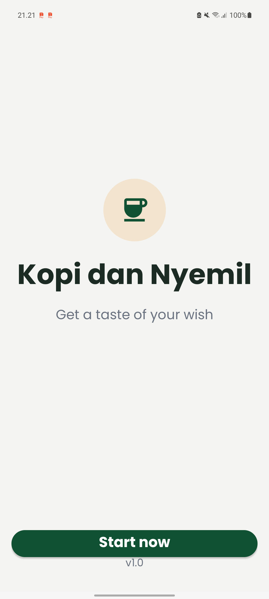
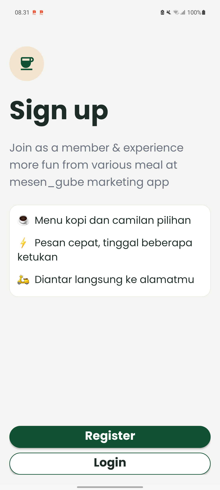
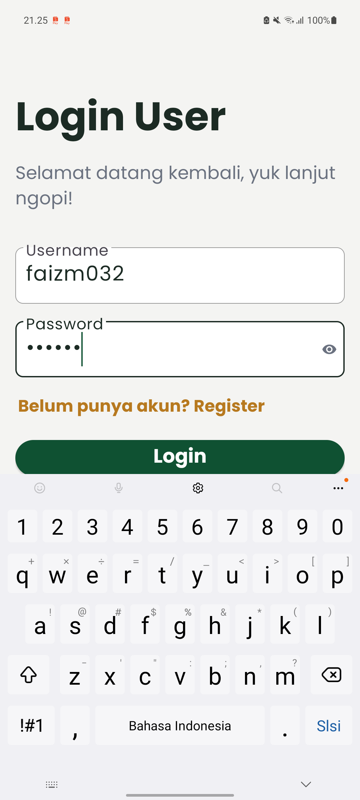
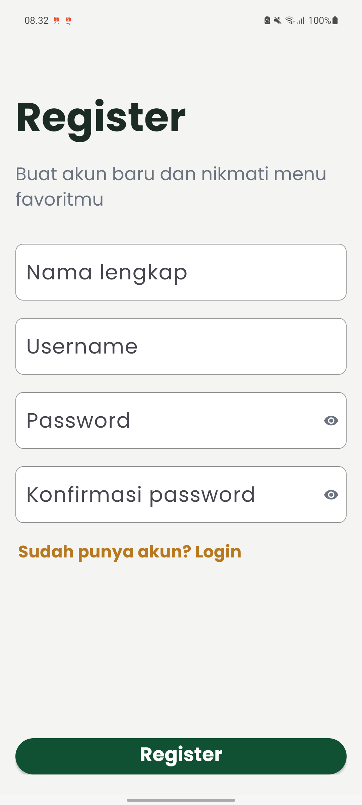
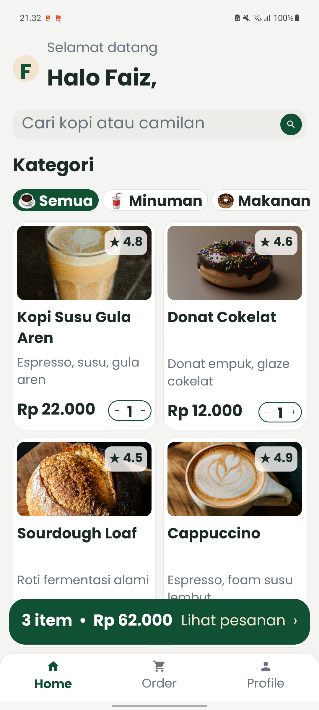
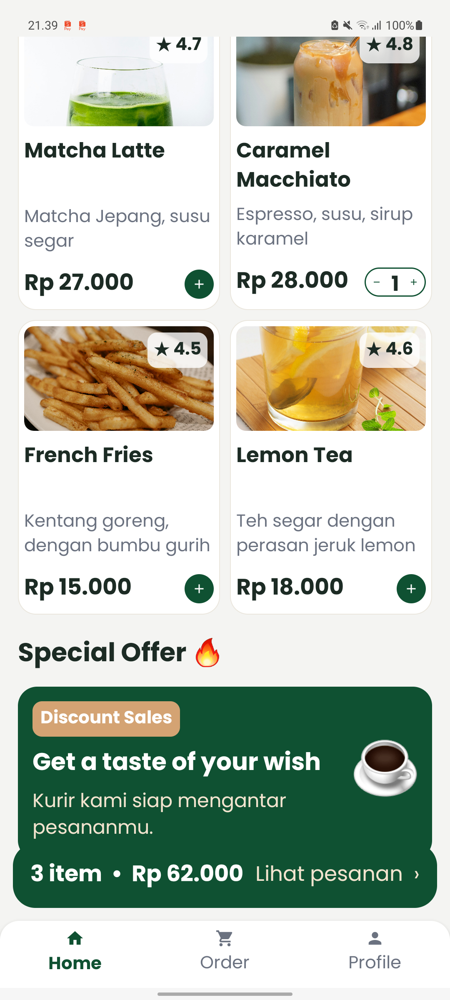
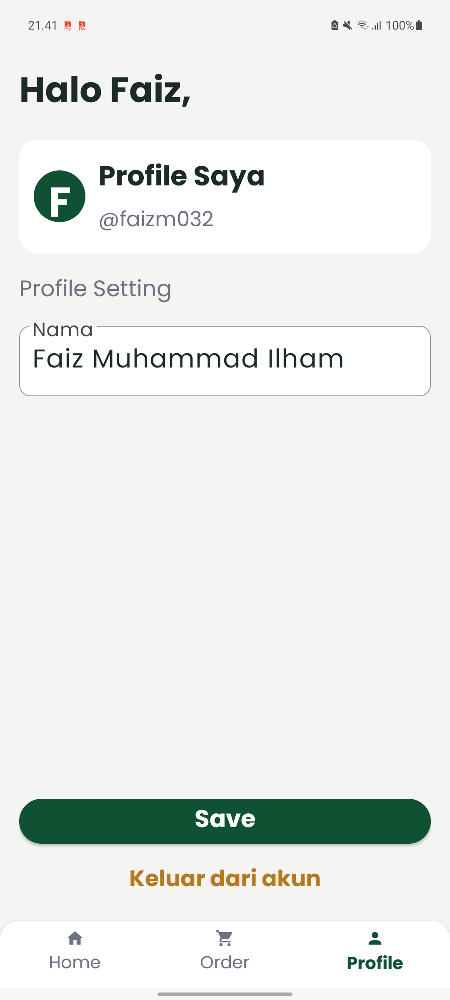
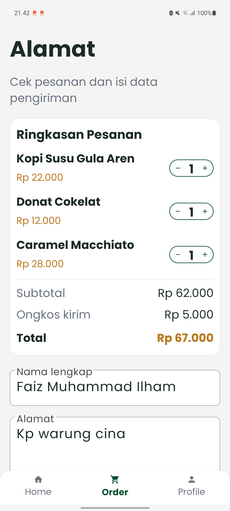
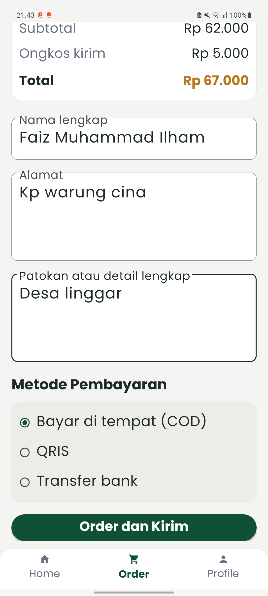
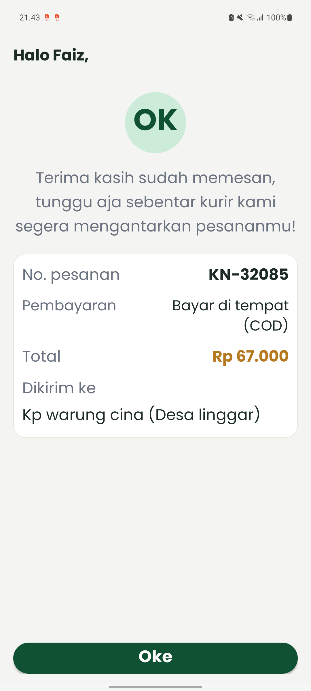

# ☕ Kopi dan Nyemil

> Get a taste of your wish

 


Aplikasi mobile Android untuk memesan kopi dan makanan ringan, dibuat sebagai tugas UTS mata kuliah **Pengembangan Aplikasi Mobile** berdasarkan wireframe "Kopi dan Nyemil".

## Deskripsi Aplikasi

Kopi dan Nyemil adalah aplikasi pemesanan kopi dan camilan. Pengguna dapat mendaftar atau masuk, melihat daftar menu makanan dan minuman, menambahkan menu ke keranjang,  menambahkan menu ke keranjang, mengisi alamat pengiriman, memilih metode pembayaran, lalu menerima konfirmasi pesanan. Aplikasi **tidak memakai database**: data menu berupa data statis (dummy data) dan data akun disimpan di perangkat dengan SharedPreferences.

| No | Layar | Deskripsi                                                                                 | Status |
|----|-------|-------------------------------------------------------------------------------------------|--------|
| 1 | Splash / Welcome | Logo cangkir, animasi masuk, tagline, tombol "Start now" | ✅ |
| 2 | Sign Up | Pilihan Register atau Login dengan kartu keunggulan | ✅ |
| 3 | Login | Input username dan password, validasi, tampilkan/sembunyikan password | ✅ |
| 4 | Register | Nama lengkap, username, password, konfirmasi password dengan validasi | ✅ |
| 5 | Home | Sapaan nama depan, banner, pencarian, kategori, daftar menu, tombol tambah ke keranjang | ✅ |
| 6 | Profile | Ubah nama, simpan, dan keluar dari akun | ✅ |
| 7 | Alamat Pengiriman (Order) | Ringkasan pesanan, ongkir, form alamat, metode pembayaran | ✅ |
| 8 | Konfirmasi Pesanan | Nomor pesanan, pembayaran, total, alamat, tombol "Oke" ke Home | ✅ |

### Pengembangan dari Wireframe

Alur dan 8 layar sesuai wireframe. Tampilan dikembangkan (tema hijau-krem, font Poppins, grid menu dengan foto dan rating) dengan fitur tambahan:

- Pencarian menu secara langsung
- Filter kategori (Semua, Minuman, Makanan)
- Keranjang dengan pengatur jumlah (− / +) dan bar total harga
- Pilihan metode pembayaran (COD, QRIS, Transfer bank)
- Logout dengan dialog konfirmasi
- Animasi Splash, transisi antar layar, dan efek tekan tombol

### Daftar Menu (Dummy Data)

| Menu | Deskripsi | Harga     |
|--|-----------|-----------|
| Kopi Susu Gula Aren | Espresso, susu, gula aren | Rp 22.000 |
| Donat Cokelat | Donat empuk, glaze cokelat | Rp 12.000 |
| Sourdough Loaf | Roti fermentasi alami | Rp 35.000 |
| Cappuccino | Espresso, foam susu lembut | Rp 25.000 |
| Matcha Latte | Matcha Jepang, susu segar | Rp 27.000 |
| Caramel Macchiato | Espresso, susu, sirup karamel | Rp 28.000 |
| French Fries | Kentang goreng, dengan bumbu gurih | Rp 15.000 |
| Lemon Tea | Teh segar dengan perasan jeruk lemon | Rp 18.000 |


### Alur Aplikasi

```
Splash → Sign Up → Register / Login → Home → Order (Alamat) → Konfirmasi → Home
                                         └→ Profile
```

## Teknologi yang Digunakan

- **Bahasa**: Kotlin
- **IDE**: Android Studio
- **UI**: XML Layout (ConstraintLayout, LinearLayout, NestedScrollView)
- **View Binding** untuk akses komponen UI
- **RecyclerView** (grid 2 kolom) untuk daftar menu
- **Material Components**, **ShapeableImageView**, dan drawable vector
- **Min SDK**: API 27 (Android 8.1)
- **Font**: Poppins
- **SharedPreferences** untuk menyimpan akun pengguna
- **Data menu**: dummy data (tanpa database)

## Struktur Project

```
app/src/main/java/lat/pam/kopidannyemil/
├── adapter/        MenuAdapter
├── data/           DummyData, Cart, UserSession, LastOrder
├── model/          MenuItem
└── *Activity.kt    Splash, SignUp, Login, Register,
                    Home, Profile, Address, Confirmation
```

## Cara Menjalankan Aplikasi

1. Pastikan Android Studio sudah terpasang.
2. Clone repository:
   ```bash
   git clone https://github.com/faizmmly/Kopi-dan-Ngemil.git
   ```
3. Buka folder project di Android Studio (**File → Open**).
4. Tunggu proses **Gradle Sync** selesai.
5. Hubungkan HP Android (aktifkan USB Debugging) atau buat emulator di **Device Manager**.
6. Klik tombol **Run ▶**.

### Alur mencoba aplikasi

**Pengguna baru**
1. Tekan **Start now**, pilih **Register**, lalu isi nama lengkap, username, dan password.
2. Setelah berhasil, kamu langsung masuk ke **Home**.

**Pengguna yang sudah punya akun**
1. Tekan **Start now**, pilih **Login**.
2. Isi username dan password yang sudah didaftarkan, lalu tekan **Login**.

**Memesan menu**
1. Di **Home**, tambahkan menu dengan tombol **+**, lalu tekan bar hijau **Lihat pesanan**.
2. Isi nama, alamat, dan patokan, pilih metode pembayaran, lalu tekan **Order dan Kirim**.
3. Di layar konfirmasi, tekan **Oke** untuk kembali ke Home.

**Profile**
1. Buka tab **Profile** untuk mengubah nama.
2. Tekan **Keluar dari akun** untuk logout, lalu masuk lagi lewat **Login**.

> Akun tersimpan di perangkat, jadi setelah aplikasi ditutup kamu cukup masuk lewat **Login** dengan akun yang sama.

## Screenshot Aplikasi

### 1. Halaman Utama & Autentikasi
| Splash / Welcome | Sign Up | Login User | Register |
| :---: | :---: | :---: | :---: |
|  |  |  |  |

### 2. Menu Home, Profile, & Transaksi
| Home (Atas & Bawah) | Profile | Alamat Pengiriman (Order) | Konfirmasi Pesanan |
| :---: | :---: | :---: | :---: |
|   |  |   |  |

## Catatan

> Password disimpan sebagai teks biasa di SharedPreferences hanya untuk keperluan demo tugas. Data pesanan tidak disimpan permanen (tanpa database).

## Identitas

- **Nama**: Faiz Muhammad Ilham
- **NIM**: 1247050032
- **Mata Kuliah**: Pengembangan Aplikasi Mobile
- **Dosen Pengampu**: H.Aldy Rialdy Atmadja, M.T. 